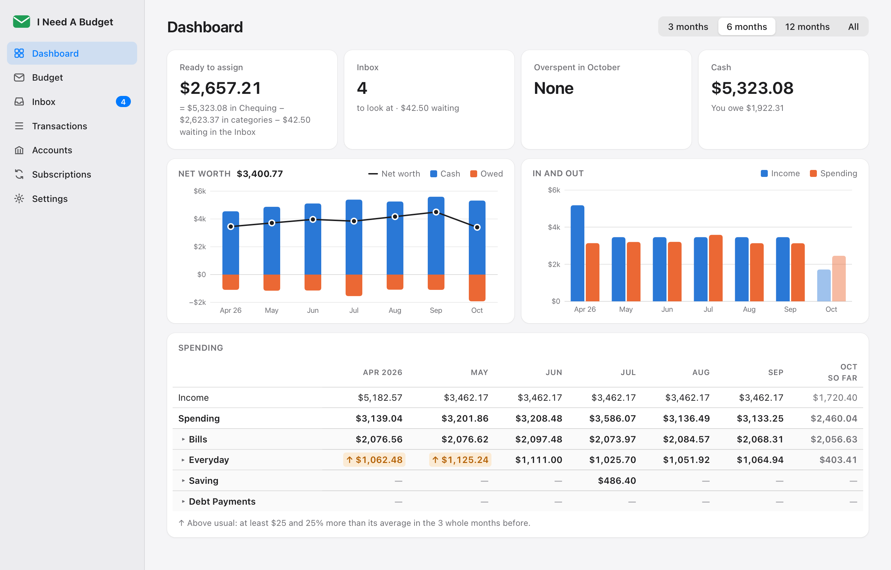
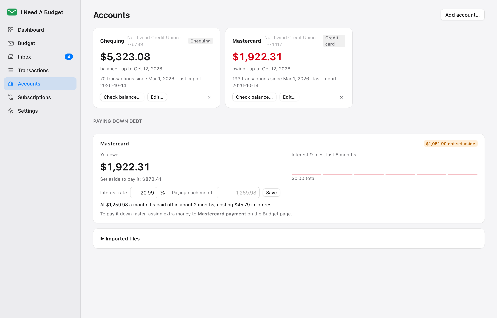

# I Need A Budget

Envelope budgeting (every dollar gets a job, like YNAB or Actual Budget) as a Mac app,
for any bank or credit union. You download your transactions from your bank's website
and the app does the rest: imports them without duplicates, cleans up the payee names,
categorizes what it recognises, and asks you only about the rest.

Everything stays on your Mac. The only thing it ever connects to is GitHub, to update
itself.

<picture>
  <source media="(prefers-color-scheme: dark)" srcset="docs/screenshots/dashboard-dark.png">
  
</picture>

Screenshots use made-up data (`scripts/demo_data.py`).

## Install

1. Download the `.dmg` from the [latest release](https://github.com/DigitalN/I-Need-A-Budget/releases/latest).
2. Open it and drag **I Need A Budget** into **Applications**.
3. Open it. The first time, macOS says it can't check the app for malware (it isn't
   notarized by Apple). Click **Done**, then in **System Settings → Privacy & Security**
   scroll down and click **Open Anyway**. That's only needed once.

From then on it updates itself: it looks for a new version each time it opens and
installs it when you quit. **Release notes** in Settings shows what changed.

Building it yourself is in [DEVELOPMENT.md](DEVELOPMENT.md).

The first time it opens, it walks you through four steps:

1. **Files:** it lists the bank downloads (and an Actual Budget export, if you have
   one) in your Downloads folder. Import them. Overlapping files are fine.
2. **Categories:** Food, Rent and the rest. Edit them any time.
3. **Balances:** what your bank shows for each account right now. Asked once (files
   that include the balance fill it in themselves).
4. **Start month:** start a few months back and catch those months up in one click, so
   your history isn't lost.

## Using it

**Getting transactions in.** On your bank's website, download an account's transactions.
**Quicken (QFX), Money (OFX) or QuickBooks (QBO)** files are best: nearly every bank
offers them, they include the balance, and they need no setting up. The app also reads
Tangerine's and RBC's CSVs as they are, and any other bank's CSV once you've shown it
which column is which (it remembers, so the next file from that bank imports on its
own). Files that land in Downloads are imported automatically and moved into the app's
own folder; a CSV that needs setting up waits at the top of the Inbox. You can also
drop files on the window. Nothing is ever imported twice, even when the same account
comes in as a CSV one day and a Quicken file the next.

**Accounts** each have a bank (type any bank or credit union; well-known ones are
suggested). A file for an account the app hasn't seen asks first: a new account, or one
you already have (a replaced card has a new number)? Pick it once and that account's
files go there from then on. If an account ever ends up in the app twice anyway, it says
so and **Merge into…** puts them back together.

**Dashboard.** Where the app opens: Ready to assign, what's in the Inbox, what's
overspent this month, and your cash and what you owe, each a click from its page. Under
them, two charts: **Net worth** (cash, what you owe, and the difference at the end of
each month) and **In and out** (income against spending, month by month); point at a
month for its figures. Then what each category group spent month by month, with income
on top. Open a group to see its categories; a month that cost clearly more than usual (at
least $25 and 25% over its average) is marked ↑. Click any figure to see the transactions
behind it. Pick 3, 6 or 12 months, or all, at the top: the whole page follows, and the
app remembers it. The window opens the size and place you last left it.

<picture>
  <source media="(prefers-color-scheme: dark)" srcset="docs/screenshots/inbox-dark.png">
  
</picture>

**Inbox.** Only what the app isn't sure about shows up here, with its best guesses.
Nothing in it counts in a category until you categorize it.
Click one (or press 1–4, Return for the first) and it's categorized. ⌘Z undoes anything.

- A payee's transactions are grouped; categorize them together, or **One at a time**.
  **Always ask** shows each on its own and stops the app categorizing that payee by itself.
- Categorizing one teaches the app: the rest from that payee it's now sure about
  categorize themselves. Except with **One at a time**, and except anyone you e-transfer
  with: they start with **Always ask** on. Switch it off for rent e-transferred to a
  landlord and the app learns it like any payee.
- Interest, bank fees and rewards are never asked about. Move one to another category
  and the next ones go there too.
- The finder at the top searches the inbox, and has a button per payee to show just theirs.
- Card payments are matched with the chequing withdrawal and marked as transfers.
  Refunds and e-transfers that pay you back go back to the category the money left from.
- "SAFEWAY #6432" and "SAVEWAY 1532" both become Safeway.

<picture>
  <source media="(prefers-color-scheme: dark)" srcset="docs/screenshots/budget-dark.png">
  
</picture>

**Budget.** Each month: what each category has, spent and got. A category's
**Budgeted** amount is the plan; money is only in it once it's assigned. Next to its
Assigned box, **→** assigns the budgeted amount and **←** what it spent, in one click, and **Assign money…**
shares out a paycheque, topping each category up to its budgeted amount in order (what's
already in it counts). Click a category, or what it spent, to see every transaction that
adds up to it this month (click one to change it), its **Monthly Budgeted Amount** (what
it actually spent in past months, last month and the 3/6/12-month averages, each with
**Use**, and the amount itself), move money and keep notes. It all saves as you type. A
group's Spent lists the whole group.

**Ready to assign** is money you really have: overspending a category comes out of it
straight away, since that money has already left the bank. Under it, a line ties it to
your balances: "= $X in Chequing − $Y in categories", and money that came in but is
still waiting in the Inbox. **Overspending** in Settings
chooses how that works: **This month** (that), **Next month** (it comes out of next
month's Ready to assign, like YNAB), or **Carry over** (the category starts next month
below zero, Ready to assign is left alone, and the next money assigned to it covers that
first).

<picture>
  <source media="(prefers-color-scheme: dark)" srcset="docs/screenshots/accounts-dark.png">
  
</picture>

**Credit cards** work like YNAB: money for card purchases moves into the card's payment
category, so the payment is covered when it's due. To pay down a balance, assign extra
to the payment category. The Accounts page shows what you owe, what's set aside, the
interest you've paid, and when it'll be paid off.

<picture>
  <source media="(prefers-color-scheme: dark)" srcset="docs/screenshots/subscriptions-dark.png">
  
</picture>

**Subscriptions and bills** are found automatically. Track each one with its own name,
category and price type:

- **Same Price** (Apple, Netflix): any other price from that payee is a question: a price
  rise, something new, or a one-off? One payee can have several, told apart by price.
- **Same Price, Different Currency** (services billed in US dollars): small exchange-rate
  changes are ignored; a real price change isn't.
- **Fluctuates Every Time** (power, utilities): any amount from that payee is the bill;
  the page shows the typical amount and range.

Give one an end date, or mark it cancelled, and you're warned in the Inbox if it charges
you after that. Putting a charge in Subscriptions asks "What's this for?" so it can be
tracked by name. Any charge you open on the Transactions page can start one too: **Track
as subscription…**.

## Privacy

Your data lives in `~/Library/Application Support/I Need A Budget` (backed up daily, 14
days kept, and before any upgrade) and never in this repository. Bank files and
databases can't be committed: a git hook refuses them, along with card numbers and
anything in your local `.git-denylist`.

## License

[GNU GPL v3](LICENSE): use it, change it and share it. Anything you share that's built
from it must be under the GPL too, with its full source, so it can't become a closed
product. Keep the [NOTICE](NOTICE) file with it so the original project stays credited.
GitHub's **Cite this repository** button (from [CITATION.cff](CITATION.cff)) gives the
reference to use.
