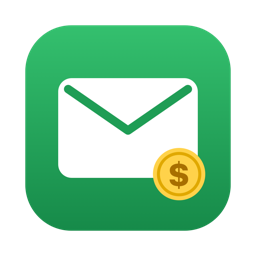
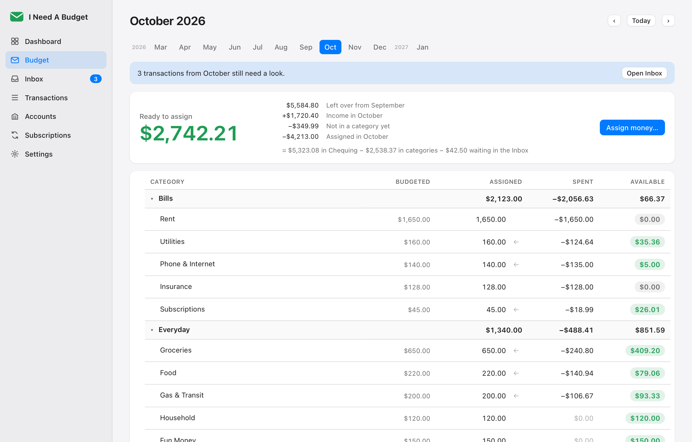
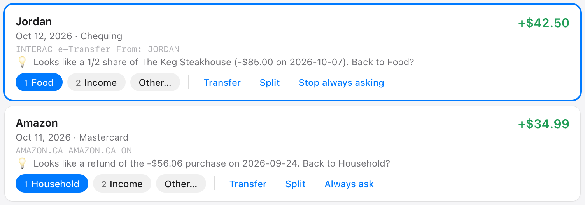
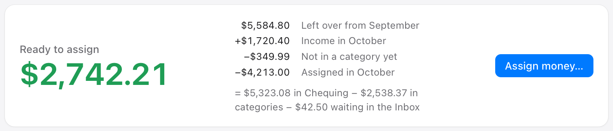
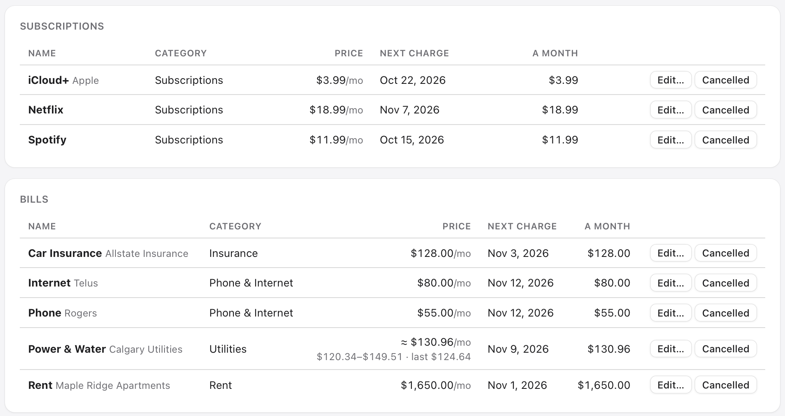
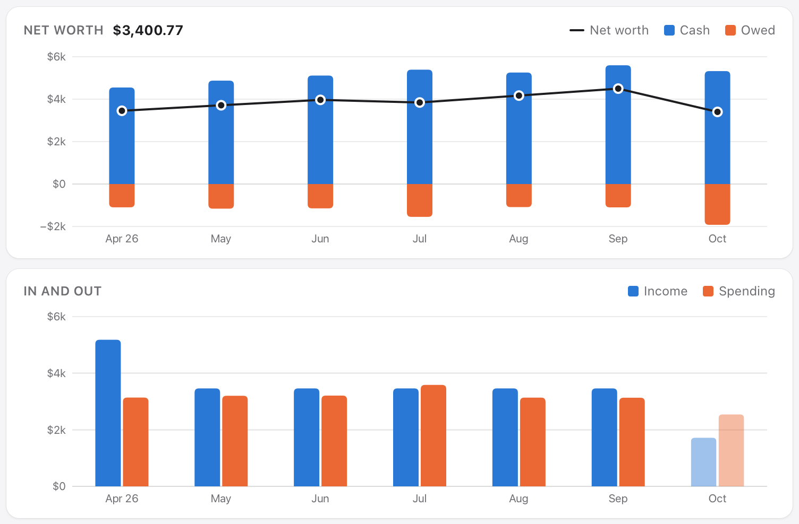

<h1 align="center">I Need A Budget</h1>

<h3 align="center">Give every dollar a job.</h3>

An envelope budget for your Mac. Download your transactions from any bank;
it sorts them and asks only about the rest. Free, and your money never leaves your Mac.

  <a href="https://github.com/DigitalN/I-Need-A-Budget/releases/latest"><b>Download for Mac</b></a>
  &nbsp;·&nbsp; <a href="#how-it-works">How it works</a>
  &nbsp;·&nbsp; <a href="#your-money-stays-on-your-mac">Privacy</a>

<picture>
  <source media="(prefers-color-scheme: dark)" srcset="docs/screenshots/budget-dark.png">
  
</picture>

All pictures use a made-up budget.

## How it works

1. **Download** your transactions from your bank's website and leave them in Downloads.
   The app picks them up.
2. **Clear the Inbox.** It categorizes what it recognises and asks about the rest, one
   click each.
3. **Give every dollar a job.** When a paycheque lands, **Assign money…** tops up each
   category to what you budgeted.

## Only asks what it doesn't know

> “Is **Costco Gas** the same as **Costco**?”

Store numbers and typos are tidied away. Refunds go back where the money came from; a
friend paying you back for dinner is matched to the dinner. Press 1–4 to pick, ⌘Z to undo.

<picture>
  <source media="(prefers-color-scheme: dark)" srcset="docs/screenshots/inbox-dark.png">
  
</picture>

## Ready to assign is real money

Overspend a category and it comes out of Ready to assign that month, so it's never more
than what's in the bank. The line under it shows the math. (Prefer YNAB's way? It's in
Settings.)

<picture>
  <source media="(prefers-color-scheme: dark)" srcset="docs/screenshots/ready-to-assign-dark.png">
  
</picture>

## Subscriptions and bills, found for you

> “Netflix was cancelled on 2026-08-02, but it charged you again”

It spots what charges you on a steady rhythm, asks when a price changes, and warns you
when something you cancelled charges you again.

<picture>
  <source media="(prefers-color-scheme: dark)" srcset="docs/screenshots/subscriptions-dark.png">
  
</picture>

## See where it goes

Net worth, and money in and out, month by month. Click any figure for the transactions
behind it.

<picture>
  <source media="(prefers-color-scheme: dark)" srcset="docs/screenshots/charts-dark.png">
  
</picture>

## Also

- **Any bank or credit union.** Quicken, Money and QuickBooks files (QFX, OFX, QBO) work
  as they are; a CSV is set up once.
- **Nothing twice.** Overlapping downloads are fine.
- **Credit cards, YNAB-style.** Card spending sets money aside for the payment; assign
  extra to pay a card down faster.
- **Coming from Actual Budget?** Leave its export in Downloads and the app learns how you
  categorize from it.

## Your money stays on your Mac

No bank login, no account to make, no subscription, no cloud. Your budget lives on your
Mac and is backed up every day. The only thing the app connects to is GitHub, to update
itself.

## Install

1. Download the `.dmg` from the [latest release](https://github.com/DigitalN/I-Need-A-Budget/releases/latest).
2. Drag **I Need A Budget** into **Applications** and open it.
3. The first time, macOS says it can't check the app for malware (it isn't notarized by
   Apple). Click **Done**, then in **System Settings → Privacy & Security** click
   **Open Anyway**. Only once.

It updates itself from then on. A short setup walks you through your files, categories and
balances. Start a few months back if you like: they catch up in one click.

## License

Free and open source under the [GNU GPL v3](LICENSE): use it, change it and share it, but
what you share stays open too. Keep the [NOTICE](NOTICE) file with it. To build it
yourself, see [DEVELOPMENT.md](DEVELOPMENT.md).
